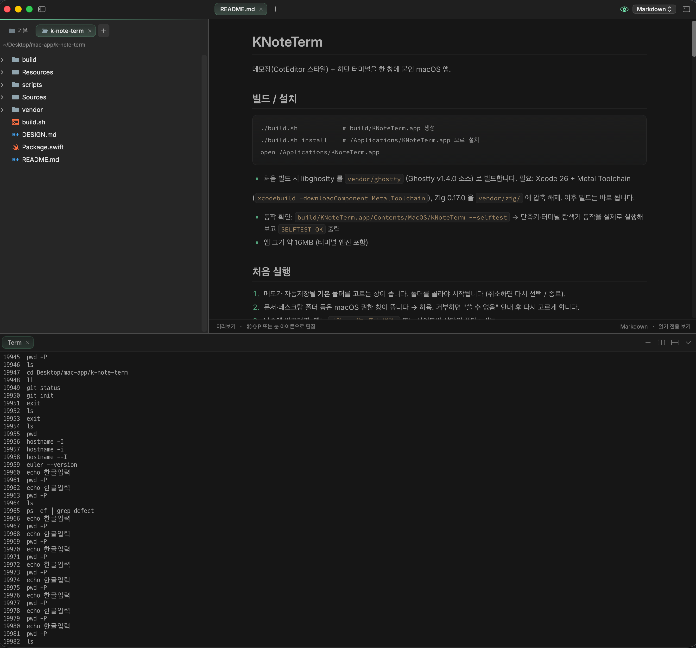

# KNoteTerm

메모장(CotEditor 스타일) + 하단 터미널을 한 창에 붙인 macOS 앱.

## 빌드 / 설치

```sh
./build.sh            # build/KNoteTerm.app 생성
./build.sh install    # /Applications/KNoteTerm.app 으로 설치
open /Applications/KNoteTerm.app
```

- 처음 빌드 시 libghostty 를 `vendor/ghostty` (Ghostty v1.4.0 소스) 로 빌드합니다. 필요: Xcode 26 + Metal Toolchain
  (`xcodebuild -downloadComponent MetalToolchain`), Zig 0.17.0 을 `vendor/zig/` 에 압축 해제. 이후 빌드는 바로 됩니다.
- 동작 확인: `build/KNoteTerm.app/Contents/MacOS/KNoteTerm --selftest` → 단축키·터미널·탐색기 동작을 실제로 실행해 보고 `SELFTEST OK` 출력
- 앱 크기 약 16MB (터미널 엔진 포함)

## 처음 실행

1. 메모가 자동저장될 **기본 폴더**를 고르는 창이 뜹니다. 폴더를 골라야 시작됩니다 (취소하면 다시 선택 / 종료).
2. 문서·데스크탑 폴더 등은 macOS 권한 창이 뜹니다 → 허용. 거부하면 "쓸 수 없음" 안내 후 다시 고르게 합니다.
3. 나중에 바꾸려면: 메뉴 `파일 > 기본 폴더 변경…` 또는 사이드바 상단의 폴더⚙ 버튼.
4. (로컬 서명이라 재빌드 후 권한을 다시 물을 수 있음)

## 단축키

**포커스에 따라 동작이 바뀝니다** — 터미널을 클릭해 둔 상태면 터미널에, 메모를 클릭해 둔 상태면 메모에, 탐색기를 클릭해 둔 상태면 폴더 탭에 적용.

| 키 | 메모에 포커스 | 터미널에 포커스 |
|---|---|---|
| ⌘T | 새 메모 (메모1.md, 메모2.md …) — 탐색기 포커스여도 새 메모 | 새 터미널 탭 |
| ⌘W | 메모 탭 닫기 | 현재 패널 닫기 (마지막 패널이면 탭 닫힘) |
| ⌘⇧] / ⌘⇧[ 또는 ⌃⇥ / ⌃⇧⇥ | 다음 / 이전 메모 탭 | 다음 / 이전 터미널 탭 |
| ⌘1 ~ ⌘9 | n번째 메모 탭 | n번째 터미널 탭 |
| ⌘= / ⌘- / ⌘0 | 에디터 글자 크게 / 작게 / 기본 | 터미널 글자 크게 / 작게 / 기본 |

탐색기(사이드바)에 포커스가 있을 때 (트리나 폴더 탭을 클릭한 상태):

| 키 | 동작 |
|---|---|
| Return | 이름 변경 (Finder 처럼 확장자 앞까지 선택) |
| ⌘↓ | 선택한 파일 열기 |
| ⌥C (⌥⌘C) | 선택한 파일/폴더 절대경로 복사 (여러 개면 줄바꿈) |
| Space | 훑어보기 (macOS Quick Look). 열린 채 ↑↓ 로 다른 파일 미리보기, Space/Esc 로 닫기 |
| ⌘⌫ | 선택한 파일/폴더를 휴지통으로 (여러 개 선택 가능, 열린 탭은 닫힘) |
| ⌘C / ⌘V | 파일 복사 / 선택한 폴더에 붙여넣기 (Finder 에서 복사한 파일도 됨, 같은 이름이면 `이름 2`) |
| ⌘Z / ⌘⇧Z | 삭제·이동·붙여넣기 되돌리기 (삭제는 원래 위치로 복구, 붙여넣은 복사본은 휴지통으로) / 다시 실행 |
| ⌘W | 현재 추가 폴더 탭 제거 (기본 폴더는 제거 불가, 실제 폴더는 그대로) |
| ⌘⇧] / ⌘⇧[ 또는 ⌃⇥ / ⌃⇧⇥ | 다음 / 이전 폴더 탭 |
| ⌘1 ~ ⌘9 | n번째 폴더 탭 (⌘1 = 기본) |

| 키 | 동작 |
|---|---|
| ⌃⌘→ 또는 ⌃⌘↓ | 다음 영역: 탐색기 → 메모 → 터미널 (보이는 것만 순환) |
| ⌃⌘← 또는 ⌃⌘↑ | 이전 영역. 포커스 없는 영역은 살짝 어둡게, 포커스 영역은 그대로 + 맨 위 민트 선 |
| ⌘N | 새 메모 (항상) |
| ⌘B | 사이드바 열기/닫기 |
| ⌘⇧T | 하단 터미널 열기/닫기 (창 높이 1/2) |
| ⌘⇧E | 에디터 숨기기/보이기 (숨기면 터미널이 에디터 자리까지 위아래 꽉 채움) |
| ⌘⇧P | 마크다운 미리보기 ↔ 편집 |
| ⌘⇧F | **전체 화면(⌃⌘F)일 때** 상단 탭바 숨기기/보이기. 터미널에 포커스가 있으면 **터미널만** 남김. 전체 화면을 빠져나오면 원래대로 |
| ⌘\\ | 에디터 분할 / 합치기 (최대 2칸) |
| ⌘⌥\\ | 에디터 분할 방향 바꾸기 (좌우 ↔ 위아래) |
| ⌘D / ⌘⇧D | 터미널 세로 / 가로 분할 (터미널이 닫혀 있으면 열기) |
| ⌘] / ⌘[ | 다음 / 이전 터미널 패널로 이동 |
| ⌘K | 터미널 화면·스크롤백 지우기 |
| ⌘O | 파일 열기 |
| ⌘⇧O | 사이드바에 폴더 추가 |
| ⌘S | 즉시 저장 (안 눌러도 자동저장) |
| ⌘F / ⌘⌥F | 찾기 / 찾아 바꾸기 |
| ⌘G / ⌘⇧G | 다음 / 이전 찾기 |
| ⌘Z / ⌘⇧Z | 실행 취소 / 복귀 (메모 탭마다 따로) |

## 화면 구성



- 위: 탐색기(폴더 탭 · 트리, 최대 30%) | 에디터(메모 탭 · 줄번호 · 상태바). 우측 상단 = 미리보기 · 분할 · 텍스트 유형 · 터미널.
- 아래: 터미널 (창 전체 너비, 탭 · 분할).

## 기능

### 우클릭 메뉴
- 탐색기: 새 메모 · 새 폴더 · 이름 변경 · 휴지통으로 이동 · 붙여넣기 · Finder 에서 보기 · 경로 복사 · **터미널에서 열기**(그 폴더에서 새 터미널 탭).
- 메모 탭: 이름 변경 · 닫기 · 다른 탭 모두 닫기 · 경로 복사 · Finder 에서 보기 · 탐색기에서 보기.
- 터미널 탭: 이름 지정 · 이름 지우기 · 탭 닫기.
- 여러 개 선택한 채 그중 하나를 우클릭하면 휴지통 이동·경로 복사가 선택 전체에 적용 (Finder 와 같음).
- 메모 탭을 바꾸면 탐색기에서 그 파일이 선택됨 (하위 폴더는 자동으로 펼침).

### 외부 파일 가져오기
- Finder 등 **앱 밖에서** 파일을 창(에디터·헤더 등)이나 Dock 아이콘에 드롭하면
  → 그 파일이 있는 폴더가 탐색기 새 탭으로 추가되고, 파일은 메모 탭에서 열림 (텍스트·PDF·이미지).
- 폴더를 드롭하면 탐색기 새 탭으로 추가.
- 단, **탐색기 트리 위에** 놓으면 그 폴더로 복사 (Finder 와 같음).
- 탐색기에서 에디터로 끌어오면 기존처럼 경로 텍스트 삽입. 터미널에 드롭하면 어디서 왔든 경로 입력.

### PDF / 이미지
- 탐색기에서 PDF·이미지(png, jpg, gif, heic, tiff, icns …)를 더블클릭하면 메모 탭에서 바로 보기 (읽기 전용).
- 이미지는 창에 맞춰 표시, PDF 는 스크롤 보기.
- **확대/축소**: ⌘+ / ⌘- (⌘0 = 화면에 맞춤), 상태바 오른쪽 `[−] 100% [+]` 버튼, 트랙패드 핀치. 배율 글자를 누르면 화면에 맞춤.
  배율은 PDF = 실제 크기 대비, 이미지 = 창에 맞춘 크기 대비.
- 상태바에 쪽수 / 픽셀 크기 표시. 그 외 파일(pptx, docx, zip …)은 더블클릭하면 Finder 처럼 기본 앱으로 열림.

### 에디터
- 상단 알약 탭: 클릭 = 전환, × 또는 휠 클릭 = 닫기, **더블클릭 = 이름 변경** (실제 파일 이름이 바뀜, 확장자는 그대로. Esc = 취소).
- **에디터 분할** (⌘\\ 또는 우측 상단 분할 아이콘): 탭 바는 그대로 하나, 칸은 최대 2개.
  - 분할하면 새 칸에 지금 파일이 그대로 → 같은 파일 두 화면 (한쪽에서 고치면 다른 쪽도 즉시 반영).
  - **탭 클릭 = 활성 칸에 표시** (활성 칸 = 위에 민트 선, 다른 칸은 살짝 어둡게). 칸을 클릭하면 그 칸이 활성.
  - 탭 **⌥클릭** 또는 우클릭 > "다른 쪽 칸에 열기" = 반대 칸에 표시 (분할 전이면 분할하면서 오른쪽에).
  - 화면에 떠 있는 탭엔 `◧`(왼쪽/위) `◨`(오른쪽/아래) 표시. 활성 칸 탭 = 민트 그라데이션, 다른 칸 탭 = 옅은 민트 테두리.
  - 칸에 떠 있던 탭을 닫으면 그 칸은 다음 탭으로. ⌃⌘←/→ 는 탐색기 → 왼쪽 칸 → 오른쪽 칸 → 터미널.
  - 다시 ⌘\\ = 활성 칸만 남기고 합치기. 분할 상태·각 칸의 파일은 재실행해도 복원.
- 왼쪽 **줄번호** (긴 줄이 접히면 첫 줄에만 번호, 현재 줄은 밝게).
- ⌘⌫: 줄 앞부분 삭제. 줄이 이미 비어 있으면(줄 맨 앞) 그 줄까지 삭제.
- 탭 바로 오른쪽 **+** = 새 메모. 탭을 모두 닫으면 새 메모를 자동으로 만들지 않고 가운데 **+** 버튼만 남음.
- 마크다운 메모는 첫 줄 오른쪽에 **작성 / 마지막 수정 일시**를 작게 표시 (파일 생성일·수정일, 저장할 때마다 갱신).
- **마크다운 미리보기**: 우측 상단 눈 아이콘 또는 ⌘⇧P 로만 켬. 파일은 항상 편집기로 열림 (미리보기 상태는 저장 안 함).
  제목·목록·체크박스·인용·코드블록·표·링크·이미지 지원. 링크 클릭 = 브라우저 (로컬 파일은 앱 탭으로).
- 아이콘 버튼에 마우스를 올리면 잠깐 뒤 설명이 뜸.
- 우측 상단 팝업에서 문법(하이라이트) 선택. 기본 폴더의 메모는 문법을 바꾸면 **확장자도 같이 바뀜** (메모1.md → JSON 선택 → 메모1.json, Plain Text = .txt). 확장자로 자동 선택되고, 직접 고른 문법은 파일별로 기억.
- 하단 상태바: 현재 줄/열, 전체 줄 수, 글자 수, 선택 글자 수, 문법, 인코딩, 저장 상태.
- UTF-8 / EUC-KR(CP949) 파일 열기 지원, 원래 인코딩으로 저장.

### 자동저장
- 입력 후 약 0.8초 뒤 자동저장, 앱 전환·⌘Q 종료 시에도 저장.
- 다시 켜면 열려 있던 메모 탭, 추가 폴더, 사이드바/터미널 표시 상태가 복원됨.
- 새 메모 이름: `메모1.md`, `메모2.md` … (기본 폴더 안의 가장 큰 번호 + 1)
- 기본 문법은 **마크다운**. 확장자를 모르는 파일과 `.txt` 도 마크다운으로 하이라이트 (우측 상단에서 변경 가능).
- 내용이 빈 메모는 탭을 닫을 때 파일도 삭제됨.
- ⚠️ 추가 폴더에서 연 파일도 자동저장됩니다 (수정 즉시 원본에 반영).

### 사이드바 (⌘B)
- 사이드바 오른쪽 경계선을 끌어 너비 조절 (최대 창 너비의 30%) → 닫았다 열어도, 재실행해도 유지. 메모 탭은 항상 사이드바 오른쪽(에디터 글자 시작 위치)에 맞춰 정렬.
- 폴더 탭: `기본` = 자동저장 폴더, 그 옆 = 추가 폴더 (× 로 목록에서 제거, 실제 폴더는 그대로). 처음 실행 시 `Downloads` 가 추가 탭으로 들어감.
- 폴더 탭 옆 **+** = 폴더 탭 추가 (⌘⇧O, 열기 창은 다운로드 폴더에서 시작).
- **`기본` 탭 더블클릭** = 기본 폴더(메모 저장 위치) 변경.
- 폴더 탭은 폴더 아이콘 + 이름 6자까지 (넘으면 `…`), 마우스를 올리면 전체 이름이 펼쳐짐.
- 파일 **더블클릭**(또는 ⌘↓) → 메모 탭에서 열림 (지원하지 않는 형식은 기본 앱으로). 한 번 클릭은 선택만. 폴더 클릭 → 펼치기/접기.
- 경로 왼쪽 복사 아이콘(또는 경로 클릭) = 폴더 경로 복사. 복사되면 아이콘이 잠깐 초록 체크로 바뀜.
- 파일 생성·삭제·이동·이름 변경은 Finder·터미널 등 **밖에서 해도 바로 반영** (FSEvents 로 현재 폴더 탭 감시). 혹시 안 맞으면 경로 오른쪽 ↻ 새로고침.
- 경로 오른쪽 👁 = 숨김 파일(.git, .env …) 보기/숨기기. 기본은 보기(켜지면 초록), 숨김 파일은 흐리게 표시.
- 탐색기·에디터·터미널은 영역 안 아무 곳(탭 줄, 빈 곳, 이미지 등)을 클릭해도 그 영역으로 포커스.
- 아이콘: [Material Icon Theme](https://github.com/material-extensions/vscode-material-icon-theme) (MIT) — 확장자별 컬러 아이콘.
- 파일·폴더를 **드래그**해서
  - 트리의 다른 폴더(또는 그 안의 파일, 빈 곳 = 현재 폴더 탭)에 놓으면 → **이동** (⌥ 누르고 놓으면 복사). 열린 탭은 새 경로를 따라감. ⌘Z 로 되돌리기
  - 에디터에 놓으면 → 절대경로 텍스트 삽입
  - 터미널에 놓으면 → 공백 등 이스케이프된 절대경로 입력
  (Finder 에서 끌어와도 동일. 한글 파일명은 NFC 로 합쳐서 넣으므로 zsh 입력줄이 깨지지 않음)

### 터미널 (⌘⇧T) — Ghostty
- 하단 터미널은 **libghostty** (Ghostty 의 터미널 엔진, GPU 렌더링). Ghostty 앱은 설치하지 않고 소스로 빌드한 라이브러리를 앱에 포함.
- `TERM=xterm-256color` 로 실행 (ssh 원격 서버에도 정의가 있어 Ctrl+L·vim·less 가 그대로 동작).
- 탭 여러 개 + 탭마다 세로/가로 분할 (⌘T / ⌘D / ⌘⇧D / ⌘W / ⌘] / ⌘K). 새 탭·분할은 현재 패널의 작업 폴더를 이어받음.
- 탭 **별칭**: 터미널 탭 더블클릭(또는 우클릭 > 이름 지정)으로 이름 입력. 비우면 자동 이름(현재 폴더)으로 돌아감.
- 로그인 셸(`$SHELL`, 보통 zsh) 실행 → `.zprofile`/`.zshrc`, alias, PATH 동일. 셸 통합으로 탭 제목 = 현재 폴더.
- 키: ⌥← / ⌥→ 단어 이동, ⌘← / ⌘→ 줄 처음/끝, ⌘⌫ 줄 삭제, ⌥⌫ 단어 삭제. ⌘C / ⌘V / ⌘A, ⌘=/⌘-/⌘0 글자 크기. 링크는 ⌘클릭으로 열기.
- 글꼴: **D2Coding 14pt** (네이버, OFL — 앱에 포함). 한글 폭이 영문의 정확히 2배라 터미널에서 한글이 띄엄띄엄 보이지 않음. D2Coding 의 끊긴 `|` 만 Source Code Pro 의 일자 막대로 대체.
- 기본 설정은 앱이 `~/Library/Application Support/KNoteTerm/ghostty.conf` 에 씀 (Anura 색, 막대 커서, D2Coding 등).
  `~/.config/ghostty/config` 를 만들면 그 설정이 우선 적용 ([Ghostty 설정 문서](https://ghostty.org/docs/config)).
- 터미널 경계선을 끌어 높이 조절. 열 때는 항상 1/2. 숨겨도(⌘⇧T) 셸은 계속 살아 있음. `exit` 하면 그 패널이 닫힘.

### 디자인
- **다크 테마**, 색감은 CotEditor **Anura (Dark)**: 에디터 #1F1F1F, 사이드바·터미널 헤더 #262626, 글자 #E5E5E5, 현재 줄 강조, 하이라이트 색(키워드 #4D92AB, 문자열 #90AD65, 주석 #808080, 숫자 #A97DD1).
- 포인트 = 민트 #72E3AD (커서, 선택 영역, 포커스 영역 윗선).
- 선택된 탭 = 민트빛 은은한 그라데이션 + 옅은 테두리 (둥근 8px). 포커스 표시 = 나머지 영역을 살짝 어둡게(iTerm/Warp 방식) + 포커스 영역 맨 위 2px 민트 선(오른쪽으로 옅어짐, VS Code 활성 탭 방식). 레이아웃·알약 탭·6px 모서리는 `DESIGN.md` 기준.
- 앱 아이콘: 아이콘 전체가 터미널 창 하나, 민트 `>_` 커서를 연필이 쓰는 모양. `swift scripts/make-icon.swift` 로 다시 그릴 수 있음 (PNG 생성 후 iconutil 로 `Resources/AppIcon.icns`).
- 폰트: UI = Inter, 에디터 = Source Code Pro, 터미널 = D2Coding (모두 앱에 포함, OFL 라이선스 `Resources/Fonts/`).

## 데이터 위치
- 메모: 처음 고른 기본 폴더 (기본값 `~/Documents/KNoteTerm/`)
- 앱 상태: `~/Library/Application Support/KNoteTerm/state.json`
